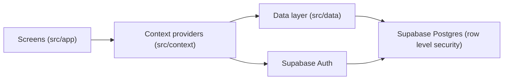

# BunkSmart

BunkSmart tracks class attendance per subject against your target percentage and calculates how many upcoming classes you can skip or must attend in a row.

[Download](#download-and-demo) | [Features](#features) | [How it works](#how-the-numbers-work) | [Getting started](#getting-started)

## Download and demo

Download the Android preview build to try BunkSmart on a physical Android device:

[Download Android APK](https://expo.dev/artifacts/eas/qai9_SRMkO6XgheR2ggHKNREMZMo8fZ-G5eUZWev7tI.apk)

On Android, allow installs from unknown sources for your browser or file manager when prompted before opening the APK.

You can sign in immediately using the demo account below or create a new account in the app:

| Field | Value |
| --- | --- |
| Email | `demo@bunksmart.app` |
| Password | `BunkSmart@2026` |

## Overview

If your college portal shows only an overall attendance percentage, you cannot see how many classes you can skip in each subject before dropping below your required threshold. Calculating those skip limits manually across different weekly schedules and cancelled classes quickly becomes error-prone.

BunkSmart solves this by tracking each subject against its own target percentage while keeping an optional link to your college portal's overall count. The app updates the screen immediately when you mark a class and syncs your records in the background over an active network connection.

## Features

### Tracking

- Mark each scheduled class as present, absent, or cancelled with one tap, or tap the active status again to clear it.
- Mark a whole day at once (all present, all absent, holiday, or clear day) with an undo option if you tap by mistake.
- Navigate to earlier dates or jump straight to a typed date to log or edit past days.
- Enter your college portal's overall attended and held counts up to a chosen date so your overall matches from day one.
- Add past subject counts directly or estimate held and attended counts from your weekly timetable.

### Planning

- See how many upcoming classes you can skip, or must attend in a row, for each subject target from 50% to 95%.
- Test skip and attend choices in the What-if simulator before skipping a class.
- Paste plain-text schedules into the timetable importer to create subjects and weekly classes in one step.
- Manage your weekly schedule by day with start times and optional end times.

### Insights

- Check your overall percentage, today's unmarked count, upcoming class preview, and subjects sorted by urgency on Overview.
- Filter subjects to show only those below target when you track more than eight subjects.
- Open any subject to review attended, held, and cancelled totals, a percentage trend chart, and month-grouped history.
- Spot your current or next class on Today with live status badges.

### Settings and experience

- Choose a default target percentage (50% to 95%) for new subjects and override targets per subject.
- Enable local class reminders 5, 10, 15, or 30 minutes before scheduled classes on Android and iOS.
- Switch between System, Light, and Dark monochrome themes at any time.
- View the Privacy Policy and Terms and Conditions, or delete all attendance data while keeping your account.

## How the numbers work

### Subject percentage

Each subject tracks attended classes (`A`), held classes (`H`), and a target percentage (`T`, from `50` to `95`). Cancelled classes are recorded in your subject totals and history, but they are never counted as held and never counted as attended.

When `H` is `0`, no percentage or allowance is shown yet. When `H > 0` and your attendance meets or exceeds the target (`100 * A >= T * H`), the skip allowance in [`src/lib/attendance.ts`](src/lib/attendance.ts) is:

```text
skip = floor((100 * A - T * H) / T)
```

When `H > 0` and your attendance is below the target (`100 * A < T * H`), the number of consecutive classes you must attend to recover in [`src/lib/attendance.ts`](src/lib/attendance.ts) uses integer ceiling division:

```text
need = T * H - 100 * A
denominator = 100 - T
attend = floor((need + denominator - 1) / denominator)
```

Worked examples at a 75% target:

- **Skipping**: With `18` attended of `22` held (`81.8%`), `100 * 18 - 75 * 22 = 150`, and `floor(150 / 75) = 2`. You can skip `2` classes (`18` of `24` is `75%`) and stay on target.
- **Recovering**: With `15` attended of `22` held (`68.1%`), `need = 75 * 22 - 100 * 15 = 150` and `denominator = 25`, giving `floor((150 + 25 - 1) / 25) = 6`. Attending the next `6` classes in a row brings you to `21` of `28`, which is `75%`.

### Overall percentage

In **college figure mode**, used when you enter a college overall count (`baseline_held > 0`) and a cutoff date (`baseline_date`), [`src/lib/overall.ts`](src/lib/overall.ts) starts from your entered attended and held counts and adds only `present` and `absent` logs dated strictly after the cutoff date. Classes marked on or before the cutoff date still count inside each subject, not again in overall, and cancelled classes are never added. For example, `96` attended of `120` held up to the cutoff date, followed by `5` present and `1` absent afterwards, gives `101` attended of `126` held (`80.1%`).

In **tracked mode**, used when no college baseline is set (`baseline_held` is `0` or `baseline_date` is empty), overall attendance sums `attended` and `held` across all tracked subjects, including each subject's starting counts and marked classes.

### Precision

Percentages shown on screen are calculated in integer tenths using `floor((A * 1000) / H)` and truncated to one decimal place (dropping `.0` on whole percentages). Because values are truncated rather than rounded, an attendance ratio below target such as `749` of `1000` displays as `74.9%` and never appears as `75%`. All target checks, skip counts, and recovery counts use whole-number arithmetic so floating-point errors cannot change a boundary result.

### What-if simulator

The What-if simulator in [`src/components/WhatIfSimulator.tsx`](src/components/WhatIfSimulator.tsx) projects upcoming attendance before you skip a class. It prefills the upcoming class count from the next 7 days of your timetable for that subject (or `4` when no slots exist, adjustable from `0` to `60`), lets you choose how many classes to skip, adds `(upcoming - skip)` to attended and `upcoming` to held, and displays the projected percentage, points difference, and updated skip or recovery target.

## Tech stack

Versions below come directly from [`package.json`](package.json) and [`app.json`](app.json).

| Area | Technology | Purpose |
| --- | --- | --- |
| Framework | Expo SDK 58 (`expo` `~58.1.0`) | Managed React Native runtime, asset loading, and Expo Go support |
| UI runtime | React Native `0.88.1`, React `19.3.0` | Cross-platform mobile and web rendering with New Architecture enabled |
| Language | TypeScript `~6.0.3` | Strict static typing across screens, state, and database rows |
| Navigation | Expo Router `~58.0.33` | File-based stack, modal, protected auth, and tab routes under `src/app` |
| Backend | `@supabase/supabase-js` `^2.119.0` | Email/password authentication and Postgres data access with RLS |
| Graphics | `react-native-svg` `15.16.0` | Circular progress rings and per-subject attendance trend charts |
| Notifications | `expo-notifications` `~58.1.10` | Weekly local class reminders on Android and iOS |
| Haptics | `expo-haptics` `~58.0.8` | Tactile feedback on attendance marks and destructive confirmations |
| Builds | EAS Build (`eas.json` `preview` profile) | Cloud Android APK generation for internal distribution |
| Typography | Geist via `expo-font` `~58.0.12` | Static `Geist-Regular`, `Geist-Medium`, and `Geist-SemiBold` font weights |

## Architecture

Screens in [`src/app`](src/app) never call Supabase directly. Instead, [`src/app/_layout.tsx`](src/app/_layout.tsx) mounts split providers from [`src/context`](src/context) (`AuthProvider`, `DataProvider`, `RemindersProvider`, and `SnackbarProvider`) so screens subscribe only to the state slices or stable action hooks they need. When a student marks a class or edits a subject, `DataProvider` updates local React state and cached `AsyncStorage` snapshots immediately, then dispatches the database call through typed helpers in [`src/data`](src/data).

The data modules (`subjects.ts`, `slots.ts`, and `logs.ts`) and `AuthProvider` share the single client configured in [`src/lib/supabase.ts`](src/lib/supabase.ts). Supabase Auth manages sessions and user metadata, while Postgres enforces per-user ownership on every query through row level security and maps database errors to readable messages via [`src/lib/errors.ts`](src/lib/errors.ts).



Important directories and files in the repository:

```text
app.json                  Expo config, icons, splash screens, and Android settings
eas.json                  EAS Build preview profile for Android APK builds
metro.config.js           Metro bundler config with capped worker count
package.json              Dependencies and verification scripts
supabase/schema.sql       Postgres schema, view, triggers, RLS policies, and grants
scripts/                  Math, date, parser verification scripts and repo audit
docs/                     Architecture, data model, theme, performance, and rules
assets/fonts/             Bundled Geist static font files (Regular, Medium, SemiBold)
assets/images/            Monochrome app icon, adaptive foreground, splash, notification icon
src/app/                  Expo Router layouts, tabs, auth screens, and modal forms
src/components/           Feature views, skeletons, and reusable UI primitives
src/constants/            In-app Privacy Policy and Terms and Conditions text
src/context/              Split Auth, Data, Reminders, and Snackbar providers
src/data/                 Typed Supabase CRUD and aggregation helpers
src/lib/                  Math engine, overall logic, dates, parser, errors, reminders
src/theme/                Monochrome light/dark tokens, theme provider, header options
src/types/                Database row interfaces and asset module declarations
```

## Database

Schema definitions live in [`supabase/schema.sql`](supabase/schema.sql), and field constraints are documented in [`docs/DATA_MODEL.md`](docs/DATA_MODEL.md).

| Object | Kind | Purpose |
| --- | --- | --- |
| `profiles` | Table | Stores per-user `full_name`, `default_target` (50 to 95), and optional college baseline fields |
| `subjects` | Table | Stores tracked courses, unique case-insensitive names per user, targets, and starting counts |
| `timetable_slots` | Table | Stores weekly class slots (`weekday` 1 to 7, `start_time`, optional `end_time`) |
| `attendance_logs` | Table | Stores daily `present`, `absent`, or `cancelled` records keyed by local `log_date` and `slot_id` |
| `subject_stats` | View | Aggregates `attended`, `conducted` (excluding `cancelled`), and `cancelled` per subject with `security_invoker = true` |
| `on_auth_user_created` and `set_updated_at` | Triggers | Creates a `profiles` row on sign-up via `handle_new_user()` and keeps `updated_at` current on updates |
| `profiles_*_own`, `subjects_own`, `timetable_slots_own`, `attendance_logs_own` | RLS policies | Restricts authenticated queries and writes so users access only rows matching `auth.uid()` |

Note: [`src/context/AuthProvider.tsx`](src/context/AuthProvider.tsx) and [`docs/DATA_MODEL.md`](docs/DATA_MODEL.md) also expect `baseline_attended`, `baseline_held`, and `baseline_date` columns on `public.profiles`, which are not yet included in [`supabase/schema.sql`](supabase/schema.sql).

## Technical decisions

- **Whole-number attendance math and truncated display**: [`src/lib/attendance.ts`](src/lib/attendance.ts) evaluates `100 * A >= T * H` with integers and truncates percentages to tenths via `Math.floor((A * 1000) / H)`, so floating-point precision cannot flip a threshold check and a value below target never rounds up to look like target.
- **Local calendar dates instead of UTC**: [`src/lib/dates.ts`](src/lib/dates.ts) formats `YYYY-MM-DD` strings from local `Date` components and avoids `toISOString`, preventing timezone offsets near midnight from shifting logs onto the wrong date.
- **Immediate local updates with background sync and split contexts**: [`src/context/DataProvider.tsx`](src/context/DataProvider.tsx) separates state, stats, derived totals, date logs, and actions into distinct contexts, caches snapshots in `AsyncStorage` with a 30-second freshness window, updates UI state immediately on taps, and rolls back if Supabase returns an error.
- **Per-user row level security and server-filled `user_id`**: [`supabase/schema.sql`](supabase/schema.sql) defaults `user_id` to `auth.uid()` and enables RLS on every table, so [`src/data`](src/data) never sends `user_id` from the client on inserts.
- **Native-driven animations with a custom tab bar**: [`src/lib/motion.ts`](src/lib/motion.ts) shares one `Animated.Value` pulse across skeletons and listens to the system reduce-motion setting, while [`src/components/ui/TabBar.tsx`](src/components/ui/TabBar.tsx) and UI motion wrappers animate only `opacity` and `transform` with the native driver.
- **On-device timetable parser with no network calls**: [`src/lib/timetableParser.ts`](src/lib/timetableParser.ts) parses day headers, inline days, 12-hour and 24-hour times, assumed durations, and break lines locally in TypeScript so raw pasted schedules never leave the device.

## Getting started

### Prerequisites

- Node.js `22.13` or newer
- A free Supabase project
- An Android phone with Expo Go matching Expo SDK 58 (`~58.1.0` in [`package.json`](package.json)), or an Android emulator

### Setup steps

1. Clone the repository and install dependencies:

   ```bash
   git clone https://github.com/mananjani2102/BunkSmart.git
   cd BunkSmart
   npm install
   ```

2. Copy [`.env.example`](.env.example) to `.env` and fill in the environment variables from your Supabase dashboard:

   | Variable | Where to find in Supabase dashboard | Expected format |
   | --- | --- | --- |
   | `EXPO_PUBLIC_SUPABASE_URL` | **Project Settings**, then **Data API** (Project URL) | `https://<project-ref>.supabase.co` |
   | `EXPO_PUBLIC_SUPABASE_KEY` | **Project Settings**, then **API Keys** (Publishable key) | `sb_publishable_<token>` |

   The publishable key is designed to be used in a client app because row level security restricts every table per user, and a secret or `service_role` key must never be put in the app.

3. Open **SQL Editor** in your Supabase project and run [`supabase/schema.sql`](supabase/schema.sql), then ensure `public.profiles` includes the `baseline_attended`, `baseline_held`, and `baseline_date` columns listed in [`docs/DATA_MODEL.md`](docs/DATA_MODEL.md).
4. In the Supabase dashboard, open **Authentication**, **Sign In / Providers**, **Email**, and turn off **Confirm email** if you want immediate sign-in after account creation.
5. Start the Metro development server:

   ```bash
   npm start
   ```

6. Scan the terminal QR code with Expo Go (SDK 58) on Android, or press `a` to launch an Android emulator.

## Verification

[`package.json`](package.json) includes seven check and verification scripts:

- `typecheck`: runs strict TypeScript type checking across the project.

  ```bash
  npm run typecheck
  ```

- `lint`: runs ESLint via Expo configuration across source and script files.

  ```bash
  npm run lint
  ```

- `audit`: checks source and docs for forbidden patterns such as em/en dashes, emoji, `console.log`, gradients, AI attribution, and unfinished task markers.

  ```bash
  npm run audit
  ```

- `verify:math`: verifies subject skip allowances, recovery counts, truncated percentages, projections, and attendance levels in [`scripts/verify-attendance.ts`](scripts/verify-attendance.ts).

  ```bash
  npm run verify:math
  ```

- `verify:overall`: verifies college figure mode and tracked mode overall calculations in [`scripts/verify-overall.ts`](scripts/verify-overall.ts).

  ```bash
  npm run verify:overall
  ```

- `verify:dates`: verifies typed `DD/MM/YYYY` date parsing, formatting, and weekday occurrence counts in [`scripts/verify-dates.ts`](scripts/verify-dates.ts).

  ```bash
  npm run verify:dates
  ```

- `verify:parser`: verifies plain-text timetable parsing, time inference, break ignoring, duplicate checks, and error reporting in [`scripts/verify-timetable-parser.ts`](scripts/verify-timetable-parser.ts).

  ```bash
  npm run verify:parser
  ```

## Build the APK

1. Install EAS CLI if needed, then log in to Expo Application Services:

   ```bash
   eas login
   ```

2. Open [`eas.json`](eas.json) and replace the `EXPO_PUBLIC_SUPABASE_URL` and `EXPO_PUBLIC_SUPABASE_KEY` values inside `build.preview.env` with your own Supabase project URL and publishable key.
3. Build the installable Android APK using the `preview` profile:

   ```bash
   eas build --platform android --profile preview
   ```

On your first Android build, EAS offers to generate and store a signing keystore automatically. When the build completes, the finished APK download link and QR code appear in the terminal output and on the build page in your Expo dashboard.

## Troubleshooting

| Symptom | Cause | Fix |
| --- | --- | --- |
| Database `"permission denied"` or `"The database refused access"` (code `42501`) | Table or view `GRANT` statements were skipped | Open the Supabase SQL Editor and rerun the `grant` statements at the end of [`supabase/schema.sql`](supabase/schema.sql) |
| Startup error `"Missing Supabase configuration"` | `.env` is missing or one of the two Supabase keys is empty | Copy [`.env.example`](.env.example) to `.env`, set both values, and restart the dev server |
| Network timeouts or failed requests on an existing project | Free-tier Supabase projects pause after a week of inactivity | Open the Supabase dashboard and restore the paused project |
| Expo Go refuses to open the project | Expo Go on the phone does not match Expo SDK 58 | Install Expo Go for SDK 58 or build the preview APK with EAS Build |
| Class reminders do not appear or arrive late on Android | Some Expo Go builds omit local reminder support, or exact alarms are disabled | Use an Android APK build, allow notifications, and enable **Alarms and reminders** in Android settings |
| Profile fetch fails on a fresh Supabase project | `baseline_attended`, `baseline_held`, and `baseline_date` are missing from `public.profiles` | Add those columns and the `profiles_baseline_valid` check documented in [`docs/DATA_MODEL.md`](docs/DATA_MODEL.md) |

## Limitations and roadmap

### Known limitations

- Timetable estimates do not know about holidays or cancelled classes, so adjust estimated held counts manually when needed.
- Past dates on the Today screen display your current timetable rather than a historical snapshot of past timetable changes.
- Class reminders are scheduled locally on one device only, do not sync across devices, and are unavailable on web browsers.
- Free Supabase projects pause automatically after a week of inactivity.

### Not included yet

- Password reset flow and self-service account deletion inside the app (account deletion is currently handled by email).
- Automatic syncing with college attendance portals.
- Remote push notifications.
- Offline write queueing (a network connection is required to persist changes).

## Privacy and terms

Both the Privacy Policy and Terms and Conditions are available inside the app under **Profile** (and linked from the Sign up screen). BunkSmart stores your account name, email, Supabase-managed password hash, subjects, weekly timetable slots, attendance logs, and optional starting counts in Supabase Postgres, while theme mode, reminder preferences, and cached snapshots are stored locally on your device.

## Credits and license

- Typography uses the Geist font by Vercel under the SIL Open Font License, bundled in [`assets/fonts`](assets/fonts).
- This repository contains an MIT license file at [`LICENSE`](LICENSE) carrying the Expo template copyright notice.

## Author

- Name: Manan Jani
- Email: `manan.jani.cg@gmail.com`
- GitHub: https://github.com/mananjani2102
